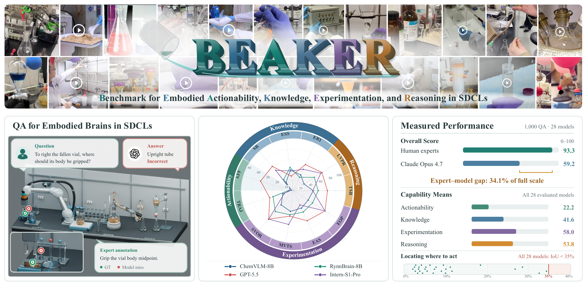

# BEAKER: An Expert-Curated Benchmark for Embodied Brains in Self-Driving Chemical Laboratories

**NeurIPS 2026 Spotlight** (Track on Evaluations and Datasets) ·
[Dataset on Hugging Face](https://huggingface.co/datasets/HydroSophyTech/BEAKER)

<p align="center">
  
</p>

This repository contains the official inference and evaluation code for BEAKER.
BEAKER evaluates whether multimodal models can perceive, ground, and reason about
operations in chemical laboratories. It contains 1,000 expert-authored questions
(600 image, 400 video) across 11 tasks and four capability dimensions:
Actionability, Knowledge, Experimentation, and Reasoning. The dataset and dataset
card are available on
[Hugging Face](https://huggingface.co/datasets/HydroSophyTech/BEAKER).

## Tasks

<table>
  <thead>
    <tr>
      <th align="center">Capability</th>
      <th align="left">Task</th>
      <th align="left">Abbreviation</th>
      <th align="right">Questions</th>
    </tr>
  </thead>
  <tbody>
    <tr>
      <td rowspan="2" align="center" valign="middle">Actionability</td>
      <td>Affordance Grounding</td>
      <td>AFF</td>
      <td align="right">150</td>
    </tr>
    <tr>
      <td>Trajectory Planning</td>
      <td>TRAJ</td>
      <td align="right">150</td>
    </tr>
    <tr>
      <td rowspan="3" align="center" valign="middle">Knowledge</td>
      <td>Equipment and Reagent Identification</td>
      <td>ERI</td>
      <td align="right">60</td>
    </tr>
    <tr>
      <td>Experimental Safety and Standardization</td>
      <td>ESS</td>
      <td align="right">60</td>
    </tr>
    <tr>
      <td>State Recognition</td>
      <td>SR</td>
      <td align="right">60</td>
    </tr>
    <tr>
      <td rowspan="4" align="center" valign="middle">Experimentation</td>
      <td>Experimental Apparatus Setup</td>
      <td>EAS</td>
      <td align="right">60</td>
    </tr>
    <tr>
      <td>Experimental Operations</td>
      <td>EOP</td>
      <td align="right">60</td>
    </tr>
    <tr>
      <td>Short-Video Operation Reasoning</td>
      <td>SVOR</td>
      <td align="right">125</td>
    </tr>
    <tr>
      <td>Mid-Video Task-Step Reasoning</td>
      <td>MVTS</td>
      <td align="right">75</td>
    </tr>
    <tr>
      <td rowspan="2" align="center" valign="middle">Reasoning</td>
      <td>Temporal Sequence Reasoning</td>
      <td>TSR</td>
      <td align="right">150</td>
    </tr>
    <tr>
      <td>Long-Video Experimental Procedure Reasoning</td>
      <td>LVPR</td>
      <td align="right">50</td>
    </tr>
  </tbody>
</table>

TSR contains 70 short-video, 50 mid-video, and 30 long-video questions. Each
image multiple-choice task contains 20 simple and 40 complex questions.

## Installation

Use Python 3.10 or newer. Video inference also requires `ffmpeg` and `ffprobe` on
`PATH`.

```bash
python -m venv .venv
source .venv/bin/activate
python -m pip install -r requirements.txt
```

Download the dataset:

```bash
hf download HydroSophyTech/BEAKER \
  --repo-type dataset \
  --local-dir BEAKER-data
```

Pass this directory to `--dataset-root`. The runners read its `image/` and
`video/` folders as published, so files inside them must not be renamed or moved.

## Model configuration

The runners use an OpenAI-compatible Chat Completions endpoint with image input
support. Example configurations are provided for hosted and local endpoints:

```text
exam/model_configs/gpt/gpt_5_5.py
exam/model_configs/local_models/chemvlm_8b.py
```

For a hosted endpoint, set the required environment variables:

```bash
export OPENAI_API_KEY="your-api-key"
export OPENAI_MODEL="your-model-name"
export OPENAI_BASE_URL="https://your-api-base-url/v1"
```

`OPENAI_BASE_URL` may be omitted when the SDK default endpoint is appropriate.
Use `BEAKER_OUTPUT_NAME` to set the answer directory name. API-key and model-name
placeholder values must be replaced before running inference.

The runners do not load model weights themselves; they send each question to a
model server over HTTP. To evaluate an open-weight model on your own GPUs, first
start a server for it with a tool such as [vLLM](https://docs.vllm.ai/), for
example:

```bash
vllm serve Qwen/Qwen2.5-VL-7B-Instruct --port 8000 \
  --limit-mm-per-prompt '{"image": 32}'
```

The server runs on your machine and accepts requests in the same format as the
OpenAI API ("OpenAI-compatible"), so the runners query it in the same way as a
hosted model. Mid-length and long-video questions send 32 images in one request,
while vLLM accepts one image per request by default; `--limit-mm-per-prompt`
raises this limit. Then point the runners to the server; `LOCAL_MODEL` must match
the model name the server uses:

```bash
export LOCAL_MODEL="Qwen/Qwen2.5-VL-7B-Instruct"
export LOCAL_BASE_URL="http://127.0.0.1:8000/v1"
export LOCAL_API_KEY="EMPTY"
```

The sampling temperature is 0.7, as in the paper, and is set by `TEMPERATURE` in
the model configuration. Set it to `None` only for endpoints that do not accept a
temperature parameter.

## Run inference

Run all tasks with a hosted endpoint:

```bash
python exam/run_benchmark_with_model.py \
  --model-config exam/model_configs/gpt/gpt_5_5.py \
  --dataset-root ./BEAKER-data \
  --output-name hosted_model \
  --skip-existing
```

Run all tasks with a local endpoint:

```bash
python exam/run_benchmark_with_model.py \
  --model-config exam/model_configs/local_models/chemvlm_8b.py \
  --dataset-root ./BEAKER-data \
  --output-name local_model \
  --skip-existing
```

Answers are written to `exam/answer/<model_name>/`. Useful options include:

- `--limit N`: run only the first N questions from each source file.
- `--skip-existing`: retain completed answers, continue an interrupted run, and
  retry questions whose API request failed.
- `--overwrite`: replace existing answer files.
- `--start-at RUNNER`: begin at a selected task runner.
- `--retries N`: set the number of attempts for failed requests or unparseable
  responses.
- `--max-output-tokens N`: override the task runner's output-token limit.

Answers are saved after every question. A request that still fails after all
attempts is saved with an `api_error` field and no answer; requests rejected as
invalid (HTTP 400, 401, 403, 404, or 422) are not retried. A runner stops
immediately when the endpoint rejects the API key, base URL, or model name, and
after five consecutive failed requests. Rerun the same command with
`--skip-existing` to retry the failed questions. Both
`run_benchmark_with_model.py` and `evaluation/evaluate_all.py` report remaining
failures, which are scored as wrong answers.

Short-, mid-, and long-video runners sample 8, 32, and 128 frames respectively.
Long-video frames are arranged into 32 chronological 2×2 grids.

## Evaluation workflow

Evaluation has two stages. Automatic tasks are scored first and an empty LVPR
expert-evaluation table is created. After an expert fills the table, the summary
script calculates all task scores, capability scores, and Overall.

### 1. Automatic evaluation and expert table

```bash
python evaluation/evaluate_all.py --models hosted_model
```

By default, predictions are read from `exam/answer/` and results are written to
`evaluation/result/<model_name>/`. Use `--answer-root` and `--result-root` for
other locations.

The script automatically evaluates ERI, ESS, SR, EAS, EOP, AFF, TRAJ, SVOR,
MVTS, and the three TSR subsets. It also creates this LVPR expert table without
overwriting an existing table:

```text
evaluation/result/<model_name>/Long-Video_Experimental_Procedure_Reasoning_scores.csv
```

### 2. Expert evaluation of LVPR

The CSV contains the question, reference answers, model answers, and empty scoring
columns. The expert fills the detail rows below the blank line. The metadata rows
at the top, including `raw_score` and `percentage`, do not need to be edited.

There are two supported scoring formats:

- Enter one question-level score from 0 to 1 in `score`.
- Enter a JSON list of per-blank scores from 0 to 1 in `blank_score`, for example
  `[1, 0, 1]`. The number of values must equal the number of reference answers.

When both fields are present, `score` takes precedence. Per-blank scores are
averaged within each question. All 50 question scores must be present. Missing,
non-numeric, non-finite, or out-of-range scores leave LVPR and its dependent
summary scores blank and produce a warning. The `judge` column may contain an
optional expert note and does not affect the score.

### 3. Task, capability, and Overall scores

After expert scoring, run:

```bash
python evaluation/build_score_summary.py
```

The command creates:

```text
evaluation/result/<model_name>/score_summary.csv
evaluation/result/all_model_score_summary.csv
```

The first file contains one model's results. The second combines all evaluated
models into one table. Before calculating summaries, the script verifies the
expected question count for every task. Partial runs and missing task rows remain
blank and cannot be reported as full benchmark results.

## Repository structure

```text
BEAKER/
├── exam/
│   ├── run_benchmark_with_model.py
│   ├── exam_common.py
│   ├── model_settings.py
│   ├── request_limits.py
│   ├── model_configs/
│   ├── imageQAtask/
│   ├── affordance/
│   ├── trajectory/
│   ├── short_video/
│   ├── mid_video/
│   └── long_video/
├── evaluation/
│   ├── evaluate_all.py
│   ├── build_score_summary.py
│   ├── image_mcq_eval.py
│   └── affordance_trajectory_eval.py
├── assets/
│   └── teaser.png
├── requirements.txt
└── LICENSE
```

Generated predictions, evaluation results, downloaded datasets, credentials,
caches, and temporary files are excluded from the repository.

## License

The code is released under the [MIT License](LICENSE). Dataset licensing and
third-party asset terms are documented in the Hugging Face dataset card.

## Contact

For questions about the benchmark or the code, email feilin@ieee.org and
zhangtengchao@ieee.org, or open an issue in this repository. 

## Citation

If you use BEAKER, please cite:

```bibtex
@inproceedings{lin2026beaker,
  title     = {{BEAKER}: An Expert-Curated Benchmark for Embodied Brains in Self-Driving Chemical Laboratories},
  author    = {Lin, Fei and Zhang, Tengchao and Gong, Ziyang and Yu, Xiaotong and Zhang, Bohan and Zhou, Yifan and Yang, Qihao and Dai, Ji and Li, Dong and Jiang, Yining and Ni, Qinghua and Huang, Jun and Zhang, Qiang and Zhou, Yue and Zhong, Zhihang and Wang, Fei-Yue and Yang, Xue and Tian, Yonglin},
  booktitle = {Advances in Neural Information Processing Systems (NeurIPS), Track on Evaluations and Datasets},
  year      = {2026}
}
```
